## Felix Bumann

I work on the future building blocks for energy system models: open tools to formulate, solve and analyse them, for example [**linopy**](https://github.com/PyPSA/linopy).

  
  

  

